<div align="center">


**Développeur full stack augmenté par l'IA** · TypeScript · React · Next.js · NestJS

📍 Clermont-Ferrand, France &nbsp;•&nbsp; 🟢 Disponible immédiatement pour un CDI

[](https://maximeguillemin.dev/)
[](https://linkedin.com/in/maxime-guillemin-5754a4262)
[](mailto:maximeguillemin77@gmail.com)


</div>

---

<div align="center">

<h3><code>max@github ~ $ ./contributions.sh</code></h3>


<br><br>

<h3><code>max@github ~ $ whoami</code></h3>
<table>
  <tr>
    <td valign="top"></td>
    <td valign="top"></td>
  </tr>
</table>

</div>

Je conçois et livre des applications web de bout en bout, et je m'appuie sur **Claude Code** pour cadrer, concevoir et coder plus vite, en **relisant et validant** chaque changement avant de le fusionner. De l'IA comme levier, pas comme pilote automatique.

---

## 🛠️ Stack

<div align="center">

**🎨 Frontend**<br/>


**⚙️ Backend & Data**<br/>


**☁️ DevOps**<br/>


**🤖 AI**<br/>


</div>

---

## 🚀 Projets phares

<div align="center">

<table>
  <tr>
    <td width="50%" valign="top">
      <h3>🖥️ Portfolio Web</h3>
      <br/><br/>
      Bureau interactif façon <i>retro computer</i> : fenêtres déplaçables, responsive mobile, multilingue (FR/EN).<br/><br/>
      <sub><code>Next.js</code> · <code>React</code> · <code>TypeScript</code> · <code>Zustand</code></sub><br/><br/>
      <a href="https://maximeguillemin.dev/">🔗 maximeguillemin.dev</a>
    </td>
    <td width="50%" valign="top">
      <h3>🔌 Serveur MCP TypeScript</h3>
      <br/><br/>
      Serveur Model Context Protocol qui relie l'API GitHub et l'API Claude, pour une meilleure collaboration entre développeurs et IA.<br/><br/>
      <sub><code>TypeScript</code> · <code>MCP</code> · <code>GitHub API</code> · <code>Claude API</code></sub>
    </td>
  </tr>
  <tr>
    <td width="50%" valign="top">
      <h3>📈 Bot de Paper Trading Multi-Agents</h3>
      <br/><br/>
      Des agents IA analysent le marché et simulent des ordres. Aucun argent réel : idéal pour tester des stratégies.<br/><br/>
      <sub><code>NestJS</code> · <code>Next.js</code> · <code>PostgreSQL</code> · <code>Claude API</code> · <code>Alpaca API</code></sub>
    </td>
    <td width="50%" valign="top">
      <h3>🐧 Linux Companion App</h3>
      <br/><br/>
      Application compagnon pour développeurs Linux, inspirée par Coucou : interface intuitive, monitoring système, intégration développeur.<br/><br/>
      <sub><code>TypeScript</code> · <code>Desktop App</code> · <code>System Monitoring</code></sub>
    </td>
  </tr>
</table>

</div>

---

## 🌱 En ce moment

```diff
+ Conception d'un serveur MCP en TypeScript
+ Apprentissage de Claude Code et de l'API Claude
+ Amélioration de l'anglais oral (B1 → B2)
! Recherche de mon premier CDI full stack en France
```

---

## 📊 Stats GitHub


<div align="center">


</div>

---

## 💬 Citation

<div align="center">

> *« Any fool can write code that a computer can understand. Good programmers write code that humans can understand. »*
> — **Martin Fowler**

</div>

---

## 🎮 Hors du code

🇯🇵 Culture japonaise &nbsp;•&nbsp; 🎮 Jeux vidéo &nbsp;•&nbsp; 🃏 Cartes à collectionner &nbsp;•&nbsp; 🧠 Développement personnel

---

## 📬 Me contacter

<div align="center">

Le plus simple : le formulaire de mon [portfolio](https://maximeguillemin.dev/), ou directement par [email](mailto:maximeguillemin77@gmail.com) / [LinkedIn](https://linkedin.com/in/maxime-guillemin-5754a4262).

*Construisons quelque chose ensemble. Avec l'IA quand c'est pertinent, avec rigueur toujours.* 🚀


</div>
